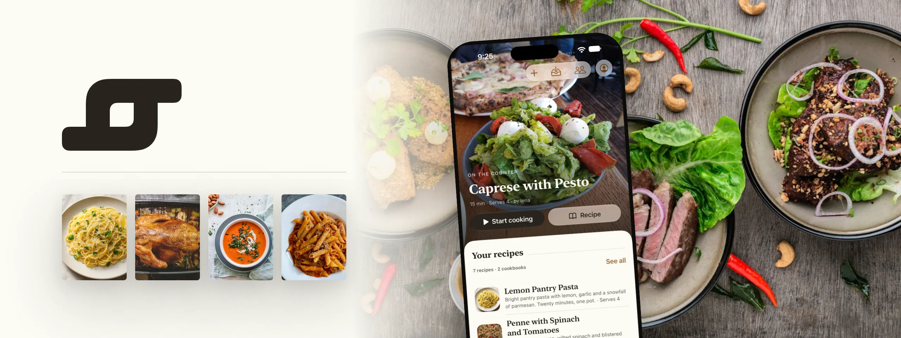
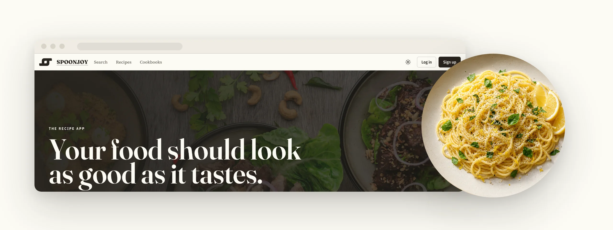
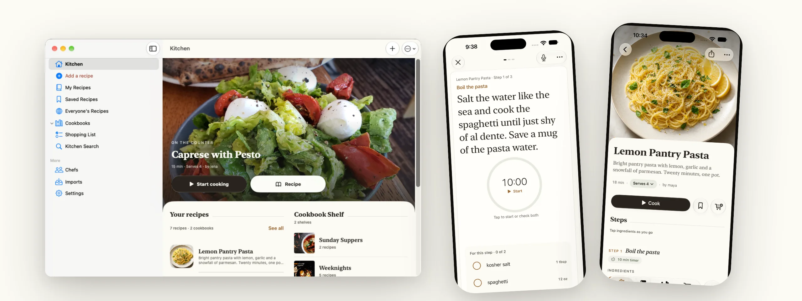

  <a href="https://spoonjoy.app"><picture>
    <source media="(prefers-color-scheme: dark)" srcset="https://raw.githubusercontent.com/spoonjoy/.github/main/brand/headers/org-dark.webp">
    
  </picture></a>

# Spoonjoy

**The recipe app for the meals you actually cook.** Recipes you can cook from one step at a time, cookbooks that grow out of real meals, and one shopping list sorted by aisle.

[**Cook a recipe now, no account needed →**](https://spoonjoy.app/test-kitchen) &nbsp;·&nbsp; [spoonjoy.app](https://spoonjoy.app) &nbsp;·&nbsp; [Support](https://spoonjoy.app/support)

<a href="https://github.com/spoonjoy/spoonjoy-v2"><picture><source media="(prefers-color-scheme: dark)" srcset="https://raw.githubusercontent.com/spoonjoy/.github/main/brand/headers/spoonjoy-v2-dark.webp"></picture></a>

**[spoonjoy-v2](https://github.com/spoonjoy/spoonjoy-v2)**: the web app, its API and its MCP server, on Cloudflare.

<a href="https://github.com/spoonjoy/spoonjoy-apple"><picture><source media="(prefers-color-scheme: dark)" srcset="https://raw.githubusercontent.com/spoonjoy/.github/main/brand/headers/spoonjoy-apple-dark.webp"></picture></a>

**[spoonjoy-apple](https://github.com/spoonjoy/spoonjoy-apple)**: the iPhone, iPad and Mac app, in SwiftUI. In internal TestFlight; not on the App Store yet.

**Bring your agent.** Spoonjoy has a [REST API and an MCP server](https://spoonjoy.app/developers) at `https://spoonjoy.app/mcp`, so an agent can write recipes, sort cookbooks and fill your shopping list. Agents can start from [spoonjoy.app/llms.txt](https://spoonjoy.app/llms.txt).

**Also here:** [spoonjoy-requests-issues](https://github.com/spoonjoy/spoonjoy-requests-issues) to ask for a feature or report a bug, and [redwoodjs-dbauth-oauth](https://github.com/spoonjoy/redwoodjs-dbauth-oauth), the OAuth sign-in plugin from Spoonjoy's RedwoodJS days. Spoonjoy's screens are built with [Ouro HX](https://ui.ouroboros.bot/).
